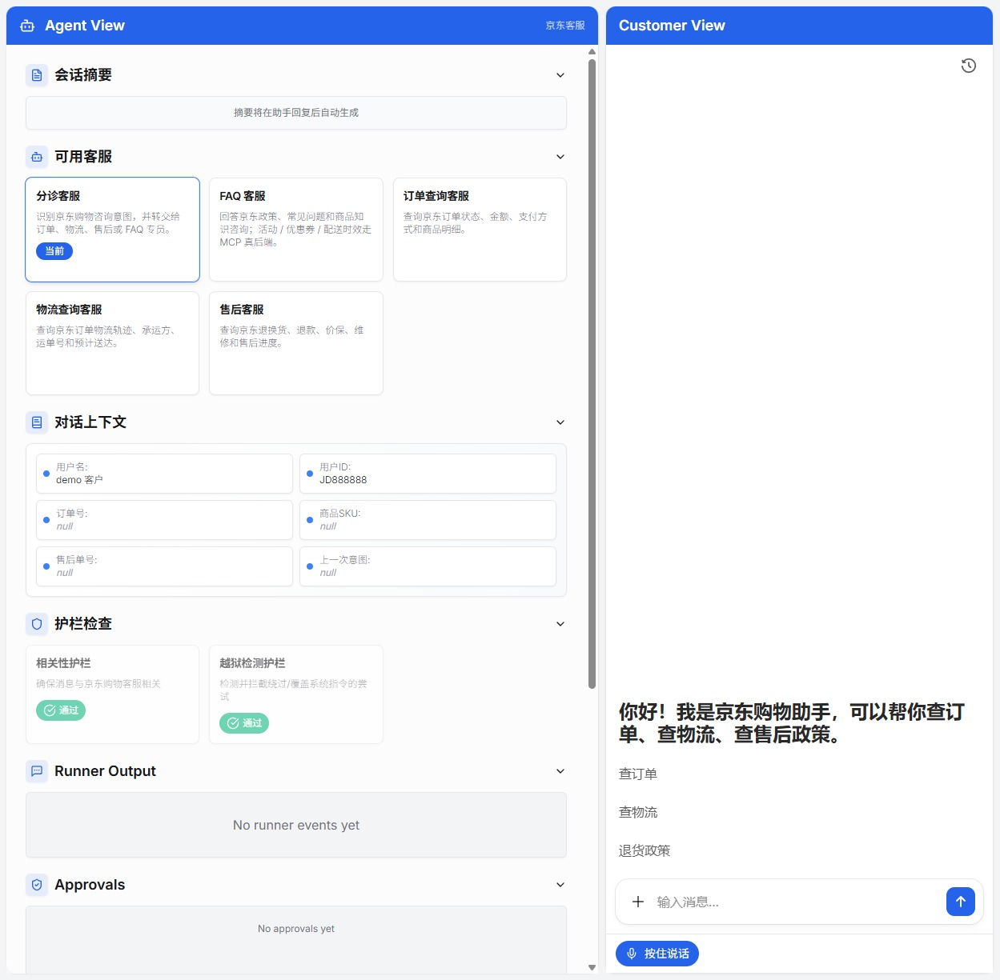

# 中文电商客服多智能体编排系统

输入订单问题，由分诊客服协调订单、物流和售后专员；退款请求暂停等待人工审批，处理过程可在本地 Trace 面板查看。

基于 [OpenAI 开源客服演示](https://github.com/openai/openai-cs-agents-demo) 扩展，使用 Agents Python SDK、ChatKit、FastAPI 和 Next.js。项目面向求职作品展示和本地集成演示。



上图为仓库已有电商界面截图。录屏步骤见 [演示脚本](docs/demo.md)。

## 从航空示例到电商工作流

上游提供客服多智能体示例及前后端基础。此仓库在其基础上扩展了：

- **中文电商领域**：订单、物流、售后、政策 FAQ 专员及共享上下文。
- **两种编排路径**：单一意图通过 handoff 交接；复合意图通过 agents-as-tools 调用最多三个专员并汇总。
- **人工审批**：退款使用 SDK 原生 `needs_approval`，批准后恢复执行；取消订单和价保使用独立审批申请。
- **可观察性**：SQLite 会话与 Trace、前端工具调用面板、结构化 CaseSummary。
- **工具与检索**：MCP stdio 服务调用 HTTP 演示后端；政策知识库支持向量检索与关键词兜底。
- **可选输入**：百炼图片识别、腾讯云语音转写。

## 哪些数据来自模拟

| 部分 | 当前实现 |
|---|---|
| 模型与编排 | 调用配置的真实模型服务，执行 Agent、工具、护栏及审批流程 |
| MCP / HTTP | 使用真实协议和 HTTP 请求，业务服务返回模拟优惠券、活动和配送 ETA |
| 订单与物流 | 来自 `python-backend/ecommerce/mock_orders.json`，包含固定历史日期 |
| 退款 | 人工批准后返回模拟退款结果，不连接支付渠道，也不更新真实订单 |
| 取消与价保 | 审批后执行模拟动作 |
| SDK 对话历史与 Trace | SQLite 持久化；Compose 使用数据卷 |
| ChatKit 线程列表、附件、审批与 CRM 工单 | 进程内存保存，后端重启后丢失；SQLite 历史不等于完整 UI 会话恢复 |

界面采用京东购物场景及模拟数据；本项目是个人扩展作品，与京东官方客服服务无关。退款成功等界面文字均属于演示业务结果。

## 本地启动

需要 Python 3.11+、Node.js 20+，以及支持工具调用的 OpenAI 兼容文本模型。图片、向量检索和语音凭证均为可选；缺少 embedding 服务时使用关键词检索。

从根目录复制配置模板：

```bash
cp .env.example .env
```

设置文本服务的 `OPENAI_BASE_URL`、`OPENAI_API_KEY` 和 `OPENAI_MODEL`。凭证也可由密钥管理器注入进程环境；不要将真实密钥提交到仓库。可选服务字段见 `.env.example`。

**Windows 本机启动**（两个终端）：

```powershell
cd python-backend
py -3 -m venv .venv
.\.venv\Scripts\python.exe -m pip install -r requirements.txt
.\.venv\Scripts\python.exe -m uvicorn main:app --host 127.0.0.1 --port 8000
```

```powershell
cd ui
npm install
npm run dev:next
```

打开 [localhost:3000](http://localhost:3000)。后端同时启动端口 9001 的模拟业务服务。前端默认转发到 `http://127.0.0.1:8000`，可用 `BACKEND_URL` 更改。

**Docker Compose**：

```bash
docker compose up --build
```

根目录 `.env` 注入后端；前端在 Compose 网络内通过 `http://backend:8000` 访问后端。SQLite 数据存储在 `backend-data` 卷中。

## 演示路线

完整录屏步骤与解说见 [演示脚本](docs/demo.md)。

1. 新建会话，输入：`帮我查一下订单 DMO20260101 的订单信息和物流。`
2. 核对工具返回的商品、142.8 元金额与签收信息。
3. 输入：`我要申请退款142.8元，原因是尺码不合适。`
4. 在左侧审批面板核对订单与金额，点击 `Approve`，观察会话恢复。
5. 展开 Trace，查看分诊、专员工具与退款执行过程。

这是固定 fixture 的演示路线。模型实际路由和回复可能变化；以工具返回值及审批状态为准。

## 代码入口

| 路径 | 用途 |
|---|---|
| `python-backend/main.py` | 模型配置、HTTP 路由、MCP 与业务服务启动 |
| `python-backend/server.py` | ChatKit 流式会话、SDK 审批恢复、SQLite Session |
| `python-backend/ecommerce/` | Agent、工具、护栏、检索、模拟订单和审批存储 |
| `python-backend/tracing_store.py` | 本地 Trace 持久化 |
| `python-backend/jd_mcp_server.py` | MCP → HTTP 工具边界 |
| `python-backend/jd_realbackend.py` | 模拟业务 HTTP 服务 |
| `ui/components/` | 对话、审批、Agent 与 Trace 面板 |

## 检查

```powershell
cd python-backend
.\.venv\Scripts\python.exe -m unittest discover -s . -p "test_*.py"
cd ../ui
npx tsc --noEmit --incremental false
```

当前测试主要覆盖配置及代码约束；真实模型对话需按上述路线单独验证。

## 运行提示

- ChatKit 前端组件从 `cdn.platform.openai.com` 加载，需要浏览器能访问该域名。若左侧 Agent View 正常、右侧持续空白，先检查组件资源加载；这与文本模型密钥是两个独立配置环节。

## 来源与许可

上游：[openai/openai-cs-agents-demo](https://github.com/openai/openai-cs-agents-demo)。此仓库保留上游 MIT 许可及 OpenAI 版权声明，见 [LICENSE](LICENSE)。电商领域扩展在本仓库维护。
