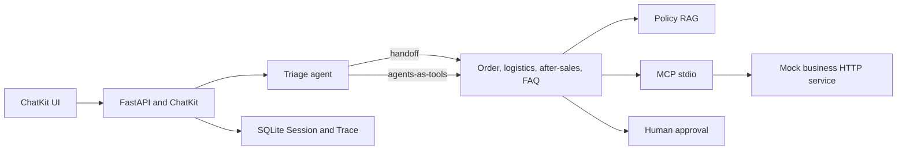

# 电商客服多智能体系统

这是一个中文电商客服示例，覆盖订单、物流、售后和政策咨询。分诊客服根据用户意图把请求交给专员；复合问题可以并行调用多个专员，再汇总成一条回复。政策查询使用 RAG，优惠和配送时效通过 MCP 工具访问业务接口，退款流程使用 SDK 原生 HITL 人工审批，Session 和 Trace 保存在本地 SQLite。

项目基于 [OpenAI 开源客服示例](https://github.com/openai/openai-cs-agents-demo)，后端使用 Agents Python SDK、ChatKit 和 FastAPI，前端使用 Next.js。

## 核心功能

- 分诊、订单、物流、售后和 FAQ 专员共享订单上下文。
- 单一意图通过 handoff 转交专员；复合意图通过 agents-as-tools 调用多个专员。
- 政策、商品知识和常见问题使用向量检索，并提供关键词检索回退。
- 优惠券、促销和配送时效通过 MCP stdio 服务连接 HTTP 业务接口。
- 退款工具使用 `needs_approval` 暂停执行，人工批准后恢复；取消订单和价保也保留审批入口。
- 前端展示当前 Agent、工具调用、审批状态、结构化会话摘要和 Trace。
- 图片识别、向量模型和语音转写作为可选服务接入。

## 架构



## 快速开始

需要 Python 3.11+、Node.js 20+，以及一个支持工具调用的 OpenAI 兼容文本模型。先复制配置模板：

```bash
cp .env.example .env
```

在根目录 `.env` 中选择一种文本模型配置。以下示例只使用占位符：

**OpenAI**

```dotenv
OPENAI_API_KEY=your-api-key
OPENAI_MODEL=gpt-4o-mini
```

**阿里云百炼**

```dotenv
OPENAI_BASE_URL=https://dashscope.aliyuncs.com/compatible-mode/v1
OPENAI_API_KEY=your-bailian-api-key
OPENAI_MODEL=qwen-plus
```

**其他 OpenAI 兼容网关**

```dotenv
OPENAI_BASE_URL=https://example.com/v1
OPENAI_API_KEY=your-api-key
OPENAI_MODEL=your-model
```

`OPENAI_BASE_URL` 可以省略，省略时使用 OpenAI SDK 默认地址。`OPENAI_MODEL` 省略时使用项目默认模型 `gpt-5.4-mini`。不要把真实密钥提交到仓库。

图片识别和向量检索使用 `DASHSCOPE_API_KEY`，语音转写使用 `TENCENTCLOUD_SECRET_ID` 与 `TENCENTCLOUD_SECRET_KEY`，两者都可留空。没有向量服务时，政策检索使用关键词回退。旧密钥文件只有在显式设置 `KEY_FILE_PATH` 时才会读取。

### Windows 本机

在第一个终端启动后端：

```powershell
cd python-backend
py -3 -m venv .venv
.\.venv\Scripts\python.exe -m pip install -r requirements.txt
.\.venv\Scripts\python.exe -m uvicorn main:app --host 127.0.0.1 --port 8000
```

在第二个终端启动前端：

```powershell
cd ui
npm install
npm run dev:next
```

打开 [http://localhost:3000](http://localhost:3000)。后端会同时启动端口 9001 的模拟业务 HTTP 服务。前端默认把请求转发到 `http://127.0.0.1:8000`，也可以通过 `BACKEND_URL` 修改。

### Docker Compose

```bash
docker compose up --build
```

Compose 从根目录 `.env` 注入后端配置，前端通过 `http://backend:8000` 访问后端，Session 和 Trace 写入 `backend-data` 数据卷。

## 使用示例

从新建会话开始，按 [使用指南](docs/demo.md) 操作。最短路径是先发送一个同时包含订单和物流的问题，再提交一笔退款申请，在审批面板批准后查看恢复执行的结果和 Trace。

## 数据与存储

- `python-backend/ecommerce/mock_orders.json` 提供固定订单、物流和售后记录；MCP HTTP 服务返回固定的优惠券、促销和配送时效数据。
- 退款、取消和价保只执行模拟业务动作，不连接支付渠道，也不修改真实订单。
- Agents SDK 会话历史和本地 Trace 写入 SQLite。默认文件位于 `python-backend/.agent_sessions.db` 和 `python-backend/.agent_traces.db`；设置 `DATA_DIR` 后可以切换目录，Compose 使用 `/app/.data`。
- ChatKit 线程列表、附件、审批记录和 CRM 工单保存在进程内存中，后端重启后会丢失。SQLite 中的 SDK 历史和 Trace 不等同于完整的 UI 状态恢复。

界面采用京东购物场景，项目与京东官方客服服务无关。

## 项目结构

| 路径 | 作用 |
|---|---|
| `python-backend/main.py` | 模型配置、HTTP 路由、MCP 和业务服务启动 |
| `python-backend/server.py` | ChatKit 流式会话、审批恢复和 SQLite Session |
| `python-backend/ecommerce/` | Agent、工具、护栏、检索、模拟订单和审批存储 |
| `python-backend/tracing_store.py` | 本地 Trace 持久化 |
| `python-backend/jd_mcp_server.py` | MCP 到 HTTP 工具边界 |
| `python-backend/jd_realbackend.py` | 模拟业务 HTTP 服务 |
| `ui/components/` | 对话、审批、Agent 和 Trace 面板 |

## 开发检查

```powershell
cd python-backend
.\.venv\Scripts\python.exe -m unittest discover -s . -p "test_*.py"
cd ..\ui
npx tsc --noEmit --incremental false
```

真实模型请求需要可用的文本模型配置；本地检查不会替代对话流程验证。

## 上游与许可

本项目基于 [openai/openai-cs-agents-demo](https://github.com/openai/openai-cs-agents-demo)。上游代码按 MIT License 发布，仓库保留 [LICENSE](LICENSE) 中的 OpenAI 版权声明和许可文本；电商客服领域扩展在本仓库维护。
